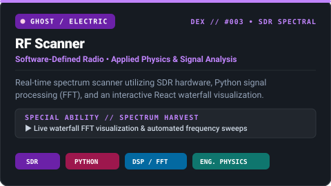
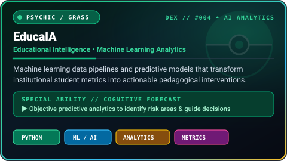

<!-- ======================================================== -->
<!-- HERO BANNER                                               -->
<!-- ======================================================== -->

  

<!-- Top Squad Lineup -->

  
  &nbsp;&nbsp;&nbsp;&nbsp;&nbsp;&nbsp;
  
  &nbsp;&nbsp;&nbsp;&nbsp;&nbsp;&nbsp;
  
  &nbsp;&nbsp;&nbsp;&nbsp;&nbsp;&nbsp;
  
  &nbsp;&nbsp;&nbsp;&nbsp;&nbsp;&nbsp;
  

<!-- Quick Navigation -->

  
  
  
  
  

  

## About Me

Hey! I'm **Diego Ovalle**, a Computer Science Engineering student with an applied background in **Engineering Physics** (completed 50% of the program).

I build software that solves real operational bottlenecks—connecting full-stack web development with process automation, data analysis, and Lean Six Sigma continuous improvement.

> *"Understand the root problem, analyze the process, build the solution, and continuously optimize it."*

 

  

  

## Tech Stack & Methodologies

### Software & Tools
Languages and frameworks I use for production apps, dashboards, and internal tooling:

  

- **Core Languages:** Python, JavaScript (ES6+), SQL, HTML5, CSS3
- **Frontend & UI:** React, Next.js, Tailwind CSS, Responsive Design
- **Backend & Data:** Django, RESTful APIs, PostgreSQL, MySQL, MongoDB

### Automation & Continuous Improvement
Engineering tools and frameworks to eliminate operational friction and standardize quality:

  
  
  
  
  

  

## Featured Projects

Selected initiatives combining full-stack development, process automation, and applied physics:

<table width="100%">
  <tr>
    <td width="50%" align="center">
      
    </td>
    <td width="50%" align="center">
      
    </td>
  </tr>
  <tr>
    <td width="50%" align="center">
      
    </td>
    <td width="50%" align="center">
      
    </td>
  </tr>
</table>

  

## Education & Background

- **Computer Science Engineering:** Algorithms, software architecture, databases, distributed systems, web development.
- **Engineering Physics (50% Completed):** Electromagnetism, signal processing (SDR), mathematical modeling, wave theory.
- **Operational Excellence & Quality:** Lean Six Sigma principles, Kaizen mindset, 5S workplace standardization, internal audit workflows.

  

## GitHub Analytics

  
  

  

  

## Get In Touch

Always open to discussing software projects, workflow automation, or problem-solving opportunities:

  
  
  
  

 

  Built with engineering precision, physical intuition, and a drive for continuous improvement.

