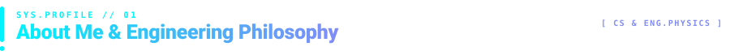
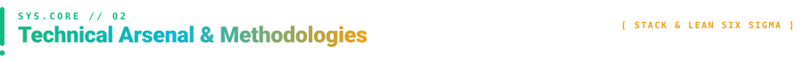
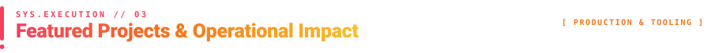
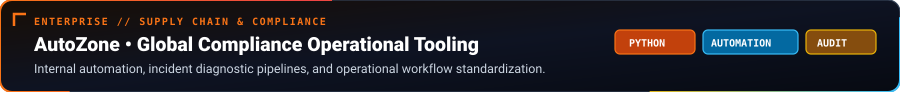
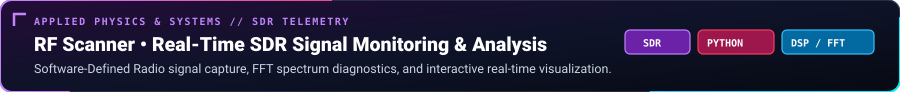
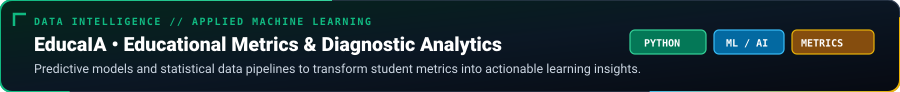
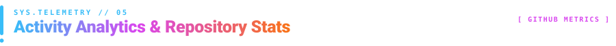

<!-- ======================================================== -->
<!-- HERO BANNER                                               -->
<!-- ======================================================== -->

  

<!-- Squad Lineup -->

  
  &nbsp;&nbsp;&nbsp;&nbsp;&nbsp;&nbsp;
  
  &nbsp;&nbsp;&nbsp;&nbsp;&nbsp;&nbsp;
  
  &nbsp;&nbsp;&nbsp;&nbsp;&nbsp;&nbsp;
  
  &nbsp;&nbsp;&nbsp;&nbsp;&nbsp;&nbsp;
  

  
  
  
  

  

<!-- ======================================================== -->
<!-- 01. ABOUT ME                                              -->
<!-- ======================================================== -->

  

I am passionate about using technology to solve real-world problems, automate processes, and create practical solutions that make operations more efficient.

My background uniquely bridges **software engineering**, **applied physics**, **process automation**, and **continuous improvement**. Along with my Computer Science Engineering studies, I have completed half of the **Engineering Physics** curriculum—providing me with strong analytical foundations in mathematical modeling, signal processing, and physical systems diagnostics.

Rather than developing software in isolation, I focus on understanding operations from the ground up: identifying bottlenecks, applying root cause analysis, and engineering scalable solutions that eliminate friction.

> **Core Narrative:**  
> *"I use technology to solve real-world problems, automate workflows and continuously improve processes."*

  

- **Dual Academic Foundation:** Computer Science Engineering &bull; Engineering Physics (50% Completed)
- **Primary Specialization:** Process Automation, Operational Tooling, Root Cause Analysis, Full-Stack Development
- **Engineering Approach:** Understand the problem, analyze the process, build the solution, and continuously improve it.

  

<!-- ======================================================== -->
<!-- 02. AREAS OF EXPERTISE                                    -->
<!-- ======================================================== -->

  

### Development & Technology
Tools and languages used to build web applications, internal dashboards, and data-driven systems:

  

- **Programming Languages:** Python, JavaScript (ES6+), SQL, HTML5, CSS3
- **Frontend Development:** React, Next.js, Tailwind CSS, Responsive Design, State Management
- **Backend & APIs:** Django, RESTful APIs, Microservices Architecture
- **Databases:** PostgreSQL, MySQL, MongoDB
- **Version Control & Tooling:** Git, GitHub, Linux Environments, VS Code

 

### Automation & Continuous Improvement
Applying structured methodologies to eliminate operational waste and optimize workflows:

- **Lean Six Sigma & Kaizen:** DMAIC process cycle, continuous improvement routines, 5S workplace standardization.
- **Root Cause Analysis (RCA):** Ishikawa (Fishbone) diagrams, 5 Whys diagnostics, failure mode identification.
- **Process Mapping & Optimization:** Flowcharts, swimlane diagrams, bottleneck elimination, Standard Operating Procedures (SOPs).
- **Workflow Automation:** Power Apps, custom automation scripts, internal task pipelines.

  
  
  
  
  

 

### Quality, Compliance & Applied Physics
Ensuring solutions meet technical standards, data integrity, and compliance requirements:

- **Quality Assurance & Auditing:** Internal audit workflows, process standardization, error-proofing (Poka-Yoke).
- **Global Compliance:** Incident tracking, regulatory discrepancy logging, operational alignment.
- **Physical Engineering Foundations:** Mathematical modeling, signal analysis, experimental validation, physical systems intuition.

  

<!-- ======================================================== -->
<!-- 03. FEATURED PROJECTS                                     -->
<!-- ======================================================== -->

  

  

- **Challenge:** Operational teams managing global supply chain compliance faced fragmented manual verification processes and recurring incident bottlenecks.
- **Engineering Solution:** Developed internal tools and automation scripts to track compliance incidents, map operational workflows, and streamline support procedures.
- **Operational Value:** Standardized incident response diagrams, reduced manual verification overhead, and improved audit visibility.

 

  

- **Challenge:** Creating recurring web layouts often involves repetitive boilerplate code, increasing frontend friction and design fragmentation.
- **Engineering Solution:** Engineered a modular builder platform enabling users to assemble web layouts using standardized, customizable components.
- **Operational Value:** Accelerates prototyping speed, enforces design consistency, and makes layout creation accessible.
- <!-- [Repository](https://github.com/DiegoOvalle348795/sectei-builder) -->

 

  

- **Challenge:** Inspecting and analyzing live radio frequency environments traditionally requires expensive proprietary hardware and complex desktop tooling.
- **Engineering Solution:** Combined Software-Defined Radio (SDR) hardware, a Python digital signal processing backend, and a responsive React frontend for live waterfall and spectrum visualization.
- **Operational Value:** Bridges physical electromagnetism with web engineering, enabling accessible spectrum analysis and frequency sweeps.
- <!-- [Repository](https://github.com/DiegoOvalle348795/rf-scanner) -->

 

  

- **Challenge:** Educational institutions frequently collect vast amounts of student performance data without actionable diagnostic mechanisms.
- **Engineering Solution:** Implemented data processing pipelines and predictive models to detect academic performance trends and assist educators in data-driven decision making.
- **Operational Value:** Empowers educators with objective, data-backed insights to drive continuous improvement in academic programs.
- <!-- [Repository](https://github.com/DiegoOvalle348795/educa-ia) -->

  

<!-- ======================================================== -->
<!-- 04. CONTINUOUS LEARNING & ACADEMICS                       -->
<!-- ======================================================== -->

  

- **Computer Science Engineering:** Software architecture, algorithms, database systems, distributed systems, web development.
- **Engineering Physics (50% Completed):** Mathematical modeling, electromagnetism, wave theory, digital signal processing, sensor analysis.
- **Operational Excellence:** Lean Six Sigma principles, Kaizen continuous improvement mindset, 5S methodology, process mapping.
- **Quality & Auditing:** Root Cause Analysis (Ishikawa), Standard Operating Procedures (SOP), compliance monitoring, error-proofing.

  

<!-- ======================================================== -->
<!-- 05. GITHUB ANALYTICS                                      -->
<!-- ======================================================== -->

  

  
  

  

  

<!-- ======================================================== -->
<!-- 06. CONNECT & COLLABORATE                                 -->
<!-- ======================================================== -->

  

I am open to discussing software projects, process automation, or technical problem-solving challenges:

  
  
  
  

 

  Built with engineering precision, physical intuition, and a drive for continuous improvement.

