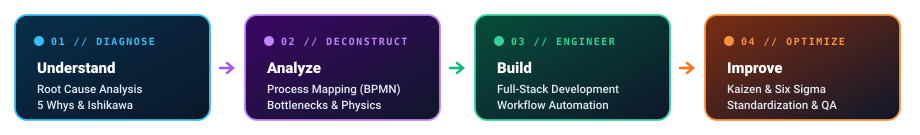

<!-- ======================================================== -->
<!-- BANNER & PROFESSIONAL HEADER                              -->
<!-- ======================================================== -->

  

<!-- 8-Bit Pokémon Engineering Squad Lineup -->

  
  &nbsp;&nbsp;&nbsp;&nbsp;
  
  &nbsp;&nbsp;&nbsp;&nbsp;
  
  &nbsp;&nbsp;&nbsp;&nbsp;
  
  &nbsp;&nbsp;&nbsp;&nbsp;
  

  
  
  
  

  

## About Me

I am passionate about using technology to solve real-world problems, automate processes, and create practical solutions that make operations more efficient.

My background uniquely bridges **software engineering**, **applied physics**, **process automation**, and **continuous improvement**. Along with my Computer Science Engineering studies, I have completed half of the **Engineering Physics** curriculum—providing me with strong foundations in mathematical modeling, signal processing, and physical systems diagnostics.

Rather than developing software in isolation, I focus on understanding operations from the ground up: identifying bottlenecks, applying root cause analysis, and engineering scalable solutions that eliminate friction.

> **Core Narrative:**  
> *"I use technology to solve real-world problems, automate workflows and continuously improve processes."*

  

- **Dual Academic Foundation:** Computer Science Engineering &bull; Engineering Physics (50% Completed)
- **Primary Specialization:** Process Automation, Operational Tooling, Root Cause Analysis, Full-Stack Development
- **Engineering Philosophy:** Understand the problem, analyze the process, build the solution, and continuously improve it.

  

<h2 id="engineering-archetypes">Tactical Squad &bull; Engineering Archetypes</h2>

To balance rigorous analytical problem-solving with software execution, I channel specific operational mindsets:

<table>
  <thead>
    <tr align="center">
      <th width="15%">Unit</th>
      <th width="20%">Designation</th>
      <th width="30%">Specialization</th>
      <th width="35%">Operational Focus</th>
    </tr>
  </thead>
  <tbody>
    <tr>
      <td align="center">
        
      </td>
      <td><b>Golurk</b> <code>Ground / Ghost</code></td>
      <td><b>Heavy Systems &amp; Automation</b></td>
      <td>Autonomous background jobs, workflow pipelines, and hardware integration. Silent, resilient system stability.</td>
    </tr>
    <tr>
      <td align="center">
        
      </td>
      <td><b>Aegislash</b> <code>Steel / Ghost</code></td>
      <td><b>Quality &amp; Dual Stance</b></td>
      <td>Switches between analytical defense (auditing, compliance, physical engineering rigor) and offensive software delivery.</td>
    </tr>
    <tr>
      <td align="center">
        
      </td>
      <td><b>Lucario</b> <code>Fighting / Steel</code></td>
      <td><b>Problem Solving &amp; Lean</b></td>
      <td>Sensing bottlenecks through data. Disciplined application of Lean Six Sigma, Kaizen, and Root Cause Analysis.</td>
    </tr>
    <tr>
      <td align="center">
        
      </td>
      <td><b>Ceruledge</b> <code>Fire / Ghost</code></td>
      <td><b>Modern Full-Stack Execution</b></td>
      <td>Dual-blade delivery cutting through UI/UX complexity with React, Next.js, and scalable Django backends.</td>
    </tr>
    <tr>
      <td align="center">
        
      </td>
      <td><b>Greninja</b> <code>Water / Dark</code></td>
      <td><b>Agile SDR &amp; Signal Analysis</b></td>
      <td>Software-Defined Radio signal processing, rapid prototyping, and adapting to dynamic frequency environments.</td>
    </tr>
  </tbody>
</table>

  

<h2 id="areas-of-expertise">Areas of Expertise</h2>

### Development & Technology
Tools and languages used to build web applications, internal dashboards, and data-driven systems:

  

- **Programming Languages:** Python, JavaScript (ES6+), SQL, HTML5, CSS3
- **Frontend Development:** React, Next.js, Tailwind CSS, Responsive Design, State Management
- **Backend & APIs:** Django, RESTful APIs, Service Architecture
- **Databases:** PostgreSQL, MySQL, MongoDB
- **Version Control & Tooling:** Git, GitHub, Linux Environments, VS Code

 

### Automation & Continuous Improvement
Applying structured methodologies to eliminate operational waste and optimize workflows:

- **Lean Six Sigma & Kaizen:** DMAIC process cycle, continuous improvement routines, 5S workplace standardization.
- **Root Cause Analysis (RCA):** Ishikawa (Fishbone) diagrams, 5 Whys diagnostics, failure mode identification.
- **Process Mapping & Optimization:** Flowcharts, swimlane diagrams, bottleneck elimination, Standard Operating Procedures (SOPs).
- **Workflow Automation:** Power Apps, custom automation scripts, internal task pipelines.

  
  
  
  
  

 

### Quality, Compliance & Applied Physics
Ensuring solutions meet technical standards, data integrity, and compliance requirements:

- **Quality Assurance & Auditing:** Internal audit workflows, process standardization, error-proofing (Poka-Yoke).
- **Global Compliance:** Incident tracking, regulatory discrepancy logging, operational alignment.
- **Physical Engineering Principles:** Mathematical modeling, signal analysis, experimental validation, physical systems intuition.

  

<h2 id="featured-projects">Featured Projects & Impact</h2>

### AutoZone &bull; Supply Chain Global Compliance Tools
*Internal automation and operational tooling for enterprise compliance workflows.*
- **Context & Problem:** Operational teams handling global supply chain compliance required centralized tracking for incidents and recurring validation bottlenecks.
- **Engineering Solution:** Developed internal tools and automation scripts to track compliance incidents, map operational workflows, and streamline support procedures.
- **Key Focus:** Python &bull; Process Mapping &bull; Workflow Automation &bull; Global Compliance Auditing

---

### SECTEI Builder &bull; Modular UI Component Platform
*Visual web interface builder designed on a reusable component architecture.*
- **Context & Problem:** Accelerating interface development while maintaining strict brand consistency and eliminating frontend boilerplate.
- **Engineering Solution:** Created a visual platform using modular, reusable components allowing fast layout assembly and standardized design patterns.
- **Key Focus:** React &bull; Next.js &bull; JavaScript &bull; Tailwind CSS &bull; Component Architecture
- <!-- [Repository](https://github.com/DiegoOvalle348795/sectei-builder) -->

---

### RF Scanner &bull; SDR Frequency Monitoring & Signal Analysis
*Real-time radio frequency scanning, signal detection, and spectrum diagnostics system.*
- **Context & Problem:** Bridging physical electromagnetism and software to provide an accessible interface for live radio frequency monitoring without expensive specialized lab hardware.
- **Engineering Solution:** Combined Software-Defined Radio (SDR) hardware, a Python digital signal processing backend, and a responsive React frontend for live waterfall and spectrum visualization.
- **Key Focus:** Applied Physics &bull; SDR &bull; Python &bull; React &bull; Signal Processing &bull; REST APIs
- <!-- [Repository](https://github.com/DiegoOvalle348795/rf-scanner) -->

---

### EducaIA &bull; Educational Data Intelligence & AI Analytics
*Analytical data platform applying machine learning to educational metrics.*
- **Context & Problem:** Extracting actionable pedagogical insights from raw institutional student performance metrics.
- **Engineering Solution:** Implemented data processing pipelines and predictive models to detect academic performance trends and assist educators in data-driven decision making.
- **Key Focus:** Python &bull; Data Analysis &bull; Machine Learning &bull; Statistical Indicators
- <!-- [Repository](https://github.com/DiegoOvalle348795/educa-ia) -->

  

## Continuous Improvement & Education

| Academic & Technical Discipline | Focus & Competencies |
| :--- | :--- |
| **Computer Science Engineering** | Software architecture, algorithms, database systems, web engineering |
| **Engineering Physics (50% Completed)** | Mathematical modeling, electromagnetism, signal processing, classical & modern physics |
| **Operational Excellence** | Lean Six Sigma principles, Kaizen mindset, 5S methodology, process mapping |
| **Quality & Auditing** | Root Cause Analysis (Ishikawa), Standard Operating Procedures (SOP), compliance monitoring |

  

## GitHub Analytics

  
  

  

  

## Connect & Collaborate

I am open to discussing software projects, process automation, or technical problem-solving challenges:

  
  
  
  

 

  Built with engineering precision, physical intuition, and a drive for continuous improvement.

