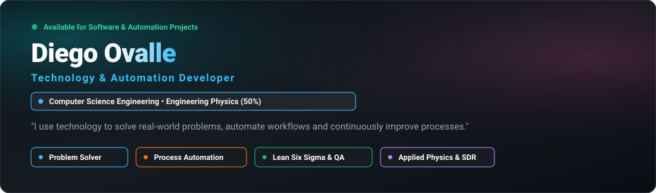

<!-- ======================================================== -->
<!-- BANNER & PROFESSIONAL HEADER                              -->
<!-- ======================================================== -->
<p align="center">
  
</p>

<p align="center">
  <a href="#-about-me"></a>
  <a href="#-development--technology"></a>
  <a href="#-automation--continuous-improvement"></a>
  <a href="#-featured-projects"></a>
</p>

---

## 👤 About Me

I am passionate about using technology to solve real-world problems, automate processes, and build practical solutions that make workflows reliable and efficient.

My background bridges **software engineering**, **process automation**, **data analysis**, and **continuous improvement**. Rather than writing code in isolation, I enjoy understanding operational bottlenecks from the ground up, diagnosing root causes, and transforming friction into functional, scalable software and automated workflows.

> **Core Philosophy:**  
> *"Understand the problem, analyze the process, build the solution, and continuously improve it."*

```
   ┌──────────────────────┐      ┌──────────────────────┐      ┌──────────────────────┐      ┌──────────────────────┐
   │    1. UNDERSTAND     │  ➔   │     2. ANALYZE       │  ➔   │      3. BUILD        │  ➔   │     4. IMPROVE       │
   │  Root Cause Analysis │      │   Process Mapping    │      │ Full-Stack & Tooling │      │  Kaizen & Continuous │
   │   5 Whys & Ishikawa  │      │  Bottleneck Removal  │      │  Workflow Automation │      │    Standardization   │
   └──────────────────────┘      └──────────────────────┘      └──────────────────────┘      └──────────────────────┘
```

- 🎓 **Education:** Computer Science Engineering Student
- 💼 **Focus Areas:** Operational Tooling, Workflow Automation, Supply Chain Compliance, Full-Stack Architecture
- 🎯 **Current Drive:** Designing resilient systems that connect operational teams with real-time data and automated tooling

---

## 🛠️ Areas of Expertise

### 💻 Development & Technology
Tools and languages I use to build robust applications, internal dashboards, and reliable services:

<p align="left">
  <a href="https://skillicons.dev">
    
  </a>
</p>

| Area | Technologies |
| :--- | :--- |
| **Languages** | Python, JavaScript (ES6+), SQL, HTML5, CSS3 |
| **Frontend** | React, Next.js, Tailwind CSS, Responsive UI Design |
| **Backend & APIs** | Django, REST APIs, Microservices Architecture |
| **Databases** | PostgreSQL, MySQL, MongoDB |
| **Version Control & DevOps** | Git, GitHub, CI/CD Basics, Environment Management |

<br />

### ⚙️ Automation & Continuous Improvement
Engineering is not just about building features—it is about optimizing how systems run:

- **Methodologies & Analysis:** Lean Six Sigma principles, Kaizen mindset, Root Cause Analysis (RCA), Ishikawa (Fishbone) Diagrams, 5 Whys.
- **Process Optimization:** Process Mapping (BPMN / Swimlane flows), Bottleneck Identification, Standard Operating Procedures (SOP).
- **Workflow Automation:** Power Apps, Automated reporting scripts, Data parsing, Operational tooling.

<p align="left">
  
  
  
  
  
</p>

<br />

### 🛡️ Quality & Compliance
Ensuring solutions meet operational standards, data integrity requirements, and regulatory auditability:

- **Quality Assurance:** Process standardization, error-proofing (Poka-Yoke), functional validation.
- **Auditing & Compliance:** Internal audit workflows, regulatory compliance tracking, discrepancy logging.
- **Continuous Monitoring:** Post-implementation tracking to ensure sustained operational gains.

---

## 🚀 Featured Projects & Impact

Here are key initiatives highlighting how I apply software development and process optimization to tangible challenges:

### 🏢 [AutoZone — Supply Chain Global Compliance Tools](#)
*Internal automation and operational tooling for enterprise compliance workflows.*
- **Challenge:** Operational teams managing global supply chain compliance faced fragmented manual verification processes and recurring incident bottlenecks.
- **Solution:** Developed internal tools and automated workflows to track incidents, map operational flows, and streamline compliance validation for Supply Chain Global Compliance.
- **Impact:** Reduced manual processing time, standardized incident response diagrams, and improved audit visibility.
- **Stack / Focus:** `Python` • `Workflow Automation` • `Process Mapping` • `Global Compliance Auditing`

---

### 🧩 [SECTEI Builder — Reusable Component Visual Platform](#)
*Visual web interface builder built on a reusable, component-driven architecture.*
- **Challenge:** Creating consistent web interfaces often requires repetitive boilerplate code and increases frontend friction.
- **Solution:** Engineered a modular builder platform enabling users to assemble web layouts using standardized, customizable components.
- **Impact:** Accelerates prototyping speed, enforces design consistency, and makes layout creation accessible.
- **Stack / Focus:** `React` • `Next.js` • `JavaScript` • `Tailwind CSS` • `Modular UI Architecture`
- <!-- Replace with real URL if public: [Repository](https://github.com/DiegoOvalle348795/sectei-builder) -->

---

### 📡 [RF Scanner — SDR Frequency Monitoring & Analysis](#)
*Real-time radio frequency scanning, signal capture, and spectrum diagnostics system.*
- **Challenge:** Inspecting and analyzing live radio frequency environments traditionally requires expensive proprietary hardware and complex desktop tooling.
- **Solution:** Built an integrated software system utilizing Software-Defined Radio (SDR) hardware, a Python processing backend, and a modern React interface for real-time visualization.
- **Impact:** Enables accessible spectrum analysis, signal identification, and automated frequency sweeps.
- **Stack / Focus:** `Python` • `SDR` • `React` • `REST APIs` • `Signal Processing`
- <!-- Replace with real URL if public: [Repository](https://github.com/DiegoOvalle348795/rf-scanner) -->

---

### 🎓 [EducaIA — Educational Data Intelligence & AI Analytics](#)
*Analytical system leveraging AI to uncover insights and improve educational outcomes.*
- **Challenge:** Educational institutions frequently collect vast amounts of student performance data without actionable diagnostic mechanisms.
- **Solution:** Designed data pipelines and analytical models to process educational indicators, flag at-risk areas, and provide actionable pedagogical recommendations.
- **Impact:** Empowers educators with objective, data-backed insights to drive continuous improvement in academic programs.
- **Stack / Focus:** `Python` • `Data Analysis` • `Machine Learning / AI` • `Predictive Metrics`
- <!-- Replace with real URL if public: [Repository](https://github.com/DiegoOvalle348795/educa-ia) -->

---

## 📊 GitHub Analytics

<p align="center">
  
  
</p>

<p align="center">
  
</p>

---

## 📜 Continuous Learning & Methodologies

```
┌─────────────────────────────────┬─────────────────────────────────┬─────────────────────────────────┐
│     OPERATIONAL EXCELLENCE      │      SOFTWARE ENGINEERING       │       QUALITY & AUDITING        │
├─────────────────────────────────┼─────────────────────────────────┼─────────────────────────────────┤
│ • Lean Six Sigma Principles     │ • Computer Science Degree (En)  │ • Process Standardization       │
│ • Root Cause Analysis (Ishikawa)│ • Full-Stack Web Architecture   │ • Internal Compliance Audits    │
│ • Kaizen Continuous Improvement │ • Modern API & Database Design  │ • Error-Proofing (Poka-Yoke)    │
│ • 5S & Workflow Streamlining    │ • Clean Code & Modular Systems  │ • Standard Operating Procedures │
└─────────────────────────────────┴─────────────────────────────────┴─────────────────────────────────┘
```

---

<details>
  <summary>🎮 <b>Pokédex Terminal Entry // Developer Card</b> <i>(Click to expand)</i></summary>

<br />

```yaml
# ========================================================
# POKÉDEX DATA SPECIFICATION // TECH & AUTOMATION UNIT
# ========================================================
Species: Technology & Automation Engineer
Type: Electric / Steel (Tech & Precision)
Trainer Class: Problem Solver
ID: DEV-0479 (Rotom-Wash form factor: Infiltrating & optimizing every appliance/system)

Base Stats:
  - Problem Solving:        ████████████████████ [99/100]
  - Process Optimization:   ██████████████████░░ [92/100]
  - Software Architecture:  █████████████████░░░ [88/100]
  - Continuous Improvement: ████████████████████ [100/100]
  - Debugging / Root Cause: ██████████████████░░ [94/100]

Ability:
  - "Process Overclock": Identifies operational friction and automates it into a silent, seamless background routine.
```

</details>

---

## 📬 Connect & Collaborate

I am always interested in discussing software projects, automation initiatives, or operational problem-solving challenges:

<p align="left">
  <a href="mailto:diego.devworks@gmail.com">
    
  </a>
  <a href="https://www.linkedin.com/in/diegoovalle">
    
  </a>
  <a href="https://www.diegoovalle.dev">
    
  </a>
  <a href="https://github.com/DiegoOvalle348795">
    
  </a>
</p>

<br />

<p align="center">
  <sub>Built with precision, data-driven curiosity, and a focus on continuous improvement.</sub>
</p>
