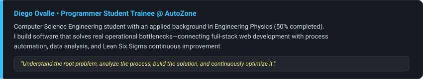
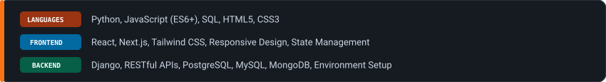
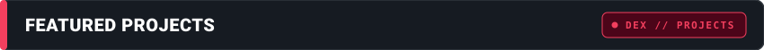
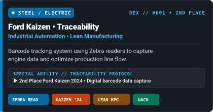
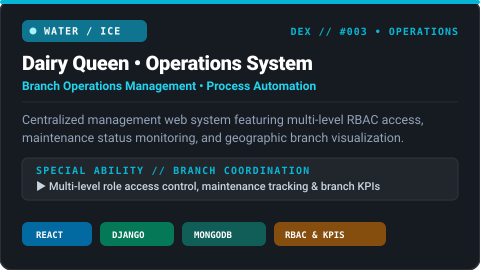
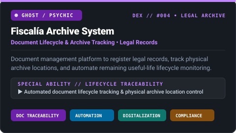
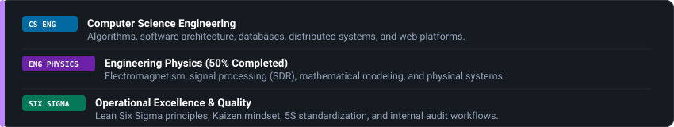
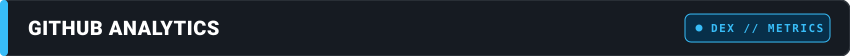
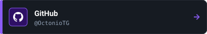
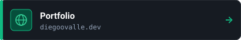

<!-- ======================================================== -->
<!-- HERO BANNER                                               -->
<!-- ======================================================== -->

  

<!-- Top Squad Lineup -->

  
  &nbsp;&nbsp;&nbsp;&nbsp;&nbsp;&nbsp;
  
  &nbsp;&nbsp;&nbsp;&nbsp;&nbsp;&nbsp;
  
  &nbsp;&nbsp;&nbsp;&nbsp;&nbsp;&nbsp;
  
  &nbsp;&nbsp;&nbsp;&nbsp;&nbsp;&nbsp;
  

<!-- Quick Navigation -->

  
  
  
  
  

  

<!-- ======================================================== -->
<!-- 01. ABOUT ME                                              -->
<!-- ======================================================== -->

  

    
  

  

 

  

  

<!-- ======================================================== -->
<!-- 02. TECH STACK & METHODOLOGIES                            -->
<!-- ======================================================== -->

  

    
  

  

  

  
  
  
  
  

  

<!-- ======================================================== -->
<!-- 03. FEATURED PROJECTS                                     -->
<!-- ======================================================== -->

  

    
  

   
  <b>"I identify inefficiencies, understand real-world processes and develop technological solutions to improve operations through automation, traceability and continuous improvement."</b>

 

<table width="100%">
  <tr>
    <td width="50%" align="center">
      
    </td>
    <td width="50%" align="center">
      
    </td>
  </tr>
  <tr>
    <td width="50%" align="center">
      
    </td>
    <td width="50%" align="center">
      
    </td>
  </tr>
</table>

  

<!-- ======================================================== -->
<!-- 04. EDUCATION & BACKGROUND                                -->
<!-- ======================================================== -->

  

    
  

  

  

<!-- ======================================================== -->
<!-- 05. GITHUB ANALYTICS                                      -->
<!-- ======================================================== -->

  

    
  

  
  

  

  

<!-- ======================================================== -->
<!-- 06. CONNECT & COLLABORATE                                 -->
<!-- ======================================================== -->

  

    
  

  
  

  
  

 

  Built with engineering precision, physical intuition, and a drive for continuous improvement.

